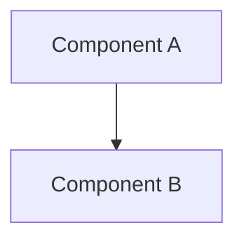
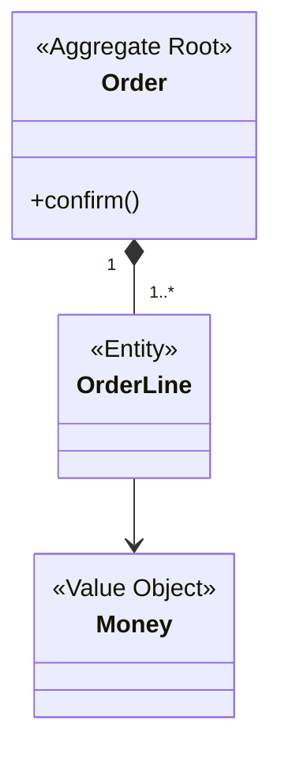
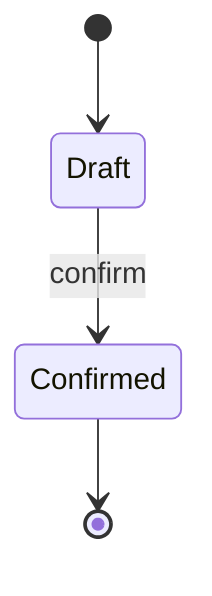
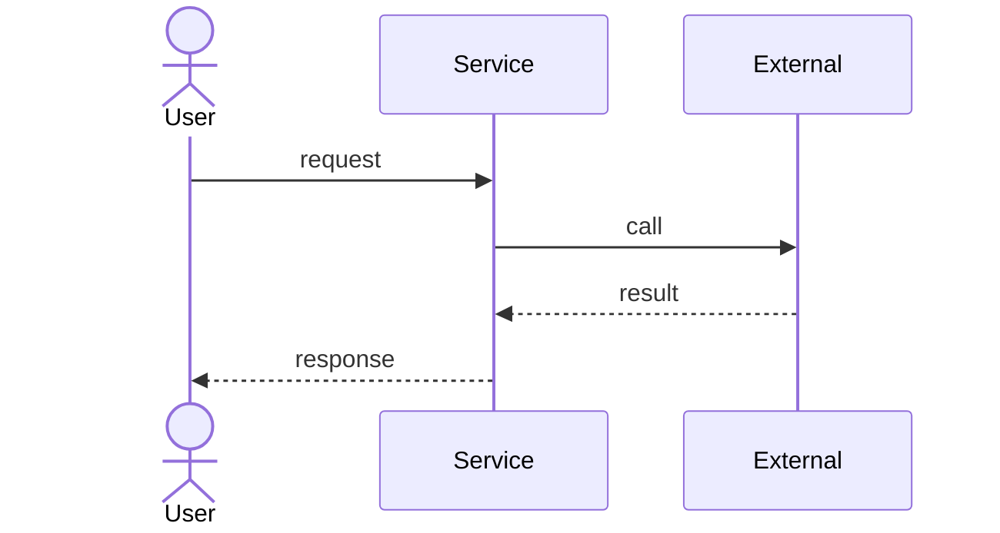

# Design Doc Template

コピー先: `docs/design/epic-NN-<topic>.md`。
`NN` は Epic Issue ID とは独立のゼロ詰め連番（`01`, `02`, …）。

---

初版で埋める節: Background / User Stories / Stories / Ubiquitous Language / Scope /
Architecture / Domain Model / Sequence Diagram。それ以外の節は Story の実装に合わせて詳細化する。
初版を出す前に、「この DesignDoc だけを読んだ人が、誰のどんな課題を解くのか説明できるか」を確かめる。

---

# Epic NN: <Title>

## Background

本書がこの Epic の要求と背景の正本（[ADR-0001](../../docs/adr/0001-designdoc-owns-requirements.md)）。
Epic issue には1〜2行の要約と本書へのリンクだけを置く。

- 解く課題: <誰の、どんな課題か>
- PRD の要件: <[docs/PRD.md](../../docs/PRD.md) のどの要件を前進させるか>
- 既存手段が不十分な理由: <…>

## User Stories

AC の正本はここ。AC は各ユーザーストーリーの下に書く。

### US-1: <短い名前>

<〈役割〉として、〈目的〉のために、〈機能〉がほしい。>

- [ ] AC 1
- [ ] AC 2

## Stories

Story issue とユーザーストーリーの対応。Story issue は対応する `US-N` の見出しにリンクする。
1つの Story が扱う AC は5個以下。

| Story issue | User Story | 扱う AC |
|---|---|---|
| #NN | US-1 | AC 1, AC 2 |

## Ubiquitous Language

この Epic で追加・変更した語。定義の正本は
[docs/UBIQUITOUS_LANGUAGE.md](../../docs/UBIQUITOUS_LANGUAGE.md) で、ここには語の名前だけを置く。

- 追加: <用語>
- 変更: <用語>（ADR-NNNN）

## Scope

この Epic が [docs/PRD.md](../../docs/PRD.md) のどの要件と
[docs/ARCHITECTURE.md](../../docs/ARCHITECTURE.md) のどのコンポーネントを前進させるかを示す。

- Epic 範囲内: <…>
- Epic 範囲外: <…（どの Epic に委ねるか）>

## Architecture

mermaid の `flowchart` / `graph` で構成図を描く（ASCII 図は不可。GitHub が描画する）。
既存の関数・ファイルはパスで参照する。

## Domain Model

mermaid の `classDiagram` で、集約・エンティティ・値オブジェクトとその関係を描く。
クラス名は [docs/UBIQUITOUS_LANGUAGE.md](../../docs/UBIQUITOUS_LANGUAGE.md) の「コード上の名前」を使う。
初版で必須。Story の実装中に追加・修正してよいが、PR 説明に変更を書いて人間の承認を得る。

| 型 | 種類 | 不変条件 |
|---|---|---|
| `<Order>` | 集約ルート | <例: 確定後は明細を変更できない> |

### State Diagram（任意）

状態を持つ集約があるときだけ、mermaid の `stateDiagram-v2` で状態と遷移の条件を描く。

### Domain Events（任意）

ドメインイベントを使うときだけ書く。

| イベント | 発行する集約 | 受け取る側 |
|---|---|---|
| `<OrderConfirmed>` | `<Order>` | <…> |

## Module Responsibilities

各モジュール/関数の「責務（する）」と「境界（しない・どこへ委譲するか）」を**表形式**で示す
（箇条書き不可）。境界列で「ここから先は他のどのモジュールの領分か」が読み取れるようにする。
他 Epic / 既存モジュールの領分は「（他 Epic 領分）」等と明記して行に含めてよい。

| モジュール / 関数 | 責務（する） | 境界（しない → 委譲先） |
|---|---|---|
| `<path>::<function>` | <このモジュールがすること> | <しないこと → 委譲先モジュール> |

## Sequence Diagram

mermaid の `sequenceDiagram` で、ユーザ／クラス／外部境界（ファイルシステム・ネットワーク・
外部API）のインタラクションを可視化する。誰がどの順で何を呼び、どう応答するかを表す。
図で表せない補足（境界の説明など）は図の下に短く添える。
参加者名とメッセージ名は [docs/UBIQUITOUS_LANGUAGE.md](../../docs/UBIQUITOUS_LANGUAGE.md) の語を使う。

## Decisions

このセクションは **Epic-scoped** な決定のみ置く（効果がこの Epic を超えないもの）。
cross-epic な決定（長期制約・アーキテクチャ変更・ライブラリ選定・公開API契約変更・
AC再解釈）は `docs/adr/` の ADR に置く。
[.claude/rules/adr-template.md](adr-template.md) と CLAUDE.md の ADR ハードルールを参照。

### Decision: <kebab-case-slug>

- What: <決定>
- Why: <動機>
- Affected modules: <一覧>
- Alternatives considered: <一覧と簡潔な理由>
- Consequences: <正負の含意>

### Cross-epic decisions (links to ADR)

- [ADR-NNNN: <title>](../adr/NNNN-<slug>.md): 一行サマリ

## Test Design Matrix

| Story \ Layer | Unit | Integration | E2E |
|---|---|---|---|
| Story N.M | ☐ | ☐ | ☐ |

完了時に ✓ を付ける。このマトリクスが Epic PR のレビューゲート。

## Story Timeline

Story 完了とキーイベントの追記専用ログ。

- YYYY-MM-DD — Story N.M completed: <一行サマリ>
