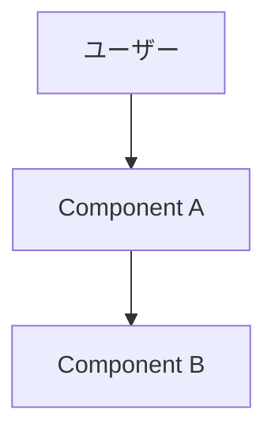
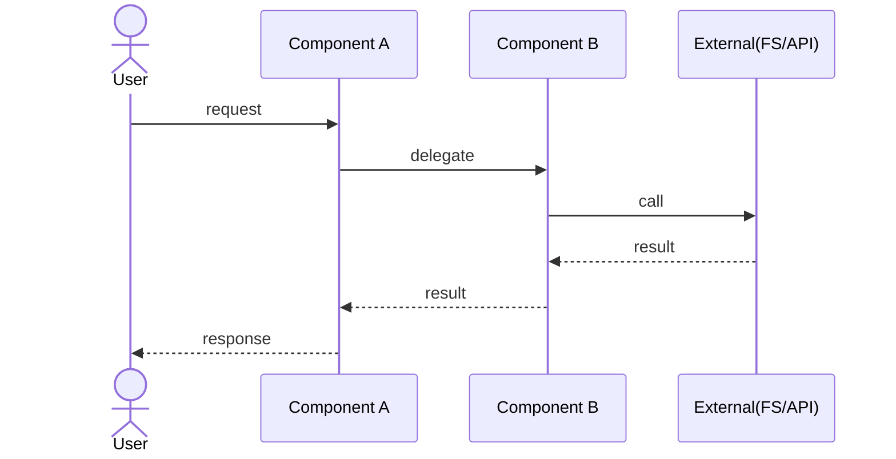

# ARCHITECTURE: <product-name>

<!-- 本書はアーキテクチャの正本。CLAUDE.md には要約とポインタのみを置く。
     要件は PRD.md、個別の設計判断は docs/adr/ を参照。
     Epic 固有の詳細はここではなく docs/design/epic-NN-*.md に書く。 -->

## 不変条件（invariants）

<!-- 全 Epic を通して守る制約を宣言する。ここを変更する場合は必ず ADR を伴う。
     例: 「常駐プロセスを持たない」「検証ロジックの正本は validate.py の1箇所」 -->

- <invariant 1>

## 構成

<!-- mermaid の flowchart / graph で全体構成を描く（ASCII 図は不可。GitHub が描画する）。 -->



## 代表シーケンス

<!-- システムを貫く代表的なユースケース1〜2本を mermaid の sequenceDiagram で描く。
     Epic 固有の詳細シーケンスは各 DesignDoc に置き、ここには「このシステムは
     こう動く」を一目で掴める全体レベルの流れだけを置く。 -->



## コンポーネントと責務

<!-- 各コンポーネントの責務と境界を全体像のレベルで書く。
     詳細な責務分割は各 Epic の DesignDoc（Module Responsibilities 表）で行う。 -->

- **<Component A>** — <責務>
- **<Component B>** — <責務>

## ディレクトリ構成

<!-- 主要ディレクトリと役割。 -->

```
<project>/
├── src/        # <役割>
├── tests/      # <役割>
└── docs/       # PRD / ARCHITECTURE / design / adr
```
