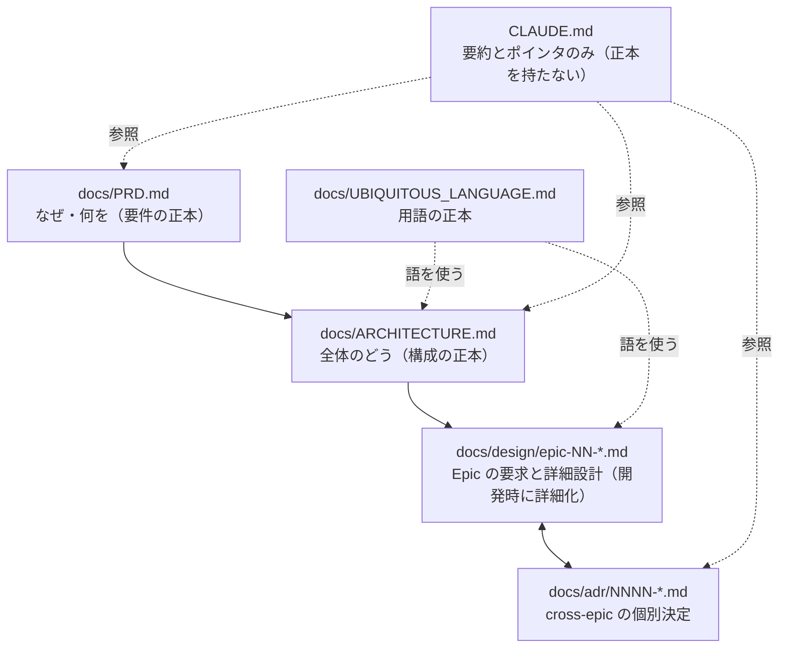
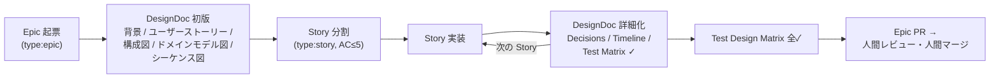

# 開発フロー正典（Epic / Story / DesignDoc / ADR）

このリポジトリが配布する開発フローの正本。CLAUDE.md には要約とポインタのみを置き、
フローの定義は本書を正とする。

## 1. 背景

要件全体を設計しきってから実装する仕様駆動開発では、仕様文書と生成コードが長くなり、
レビューする人間の理解が追いつかなくなる。このフローは要件を**動作確認できる最小単位**
（Story）に分割し、そのまとまり（Epic）ごとの DesignDoc を開発しながら詳細化する。
こうして、AI が作ろうとしているもの・作ったものと、人間が理解している内容とのずれを小さくする。
一度に精査する情報量を絞ることが目的であり、文書を書くこと自体は目的ではない。

経験上、特に効果が高い次の2つを、このフローの必須要素とする。

- ADR: 設計判断を1決定1ファイルで記録し、「なぜこうなっているか」を後から追える
- シーケンス図（mermaid `sequenceDiagram`）: 誰がどの順で何を呼ぶかを人間が一目で検証できる

あわせて、DesignDoc だけを読めば要求から設計までをたどれること（[ADR-0001](adr/0001-designdoc-owns-requirements.md)）と、
文書・コード・テスト・図が同じ語で書かれていること（[ADR-0002](adr/0002-ubiquitous-language.md)）を守る。

## 2. 文書階層と正本ルール

| 文書 | 正本として持つもの | 持たないもの |
|---|---|---|
| `docs/PRD.md` | ビジョン、コアバリュー、機能/非機能要件、スコープ外、Epic ロードマップ、成功基準 | 実現方法 |
| `docs/ARCHITECTURE.md` | 不変条件、全体構成図、コンテキストマップ、コンポーネント責務、ディレクトリ構成 | Epic 固有の詳細 |
| `docs/UBIQUITOUS_LANGUAGE.md` | 用語・コード上の名前・定義・使わない言い換え | 設計の説明 |
| `docs/design/epic-NN-*.md` | Epic の背景・ユーザーストーリー・AC・Scope・構成図・ドメインモデル図・シーケンス図・責務表・Epic-scoped な決定・Test Design Matrix | cross-epic の決定（→ ADR）、用語の定義（→ UBIQUITOUS_LANGUAGE） |
| `docs/adr/NNNN-*.md` | cross-epic 決定・長期制約・ARCHITECTURE への変更 | Epic 内で完結する決定（→ DesignDoc） |
| `CLAUDE.md` | AI への行動指示と各正本へのポインタ | 上記すべての実体 |

**ルール: 同じ情報を2箇所に正本として書かない**。要約とポインタは書いてよいが、実体を複製してはいけない。
CLAUDE.md の肥大化はこのルールで構造的に防ぐ。

## 3. Issue の2階層

| | Epic | Story |
|---|---|---|
| label | `type:epic` | `type:story` |
| 単位 | まとまった価値への一歩。DesignDoc を必ず伴う | **動作確認可能な最小単位**。0.5–3日 |
| issue に書くこと | 1〜2行の要約と DesignDoc へのリンク | 親 Epic、対応するユーザーストーリーへのリンク、やること |
| Acceptance Criteria | DesignDoc の User Stories に書く（正本） | 扱う AC は **5個以下**。超えたら Story を分割 |
| 起票フォーム | `.github/ISSUE_TEMPLATE/epic.yml` | `.github/ISSUE_TEMPLATE/story.yml` |

分割の判定基準は「レビューする人間が、その単位の DesignDoc と差分を**一度に読んで
精査しきれるか**」。迷ったら小さくする。

## 4. ライフサイクル

1. Epic 起票: issue には1〜2行の要約だけを書く。背景・AC は DesignDoc に書く。
2. DesignDoc 初版: [.claude/rules/design-doc-template.md](../.claude/rules/design-doc-template.md)
   を `docs/design/epic-NN-<topic>.md` にコピーして書く。初版で埋めるのは Background・
   User Stories（AC を含む）・Stories・Ubiquitous Language・Scope・Architecture 図・
   Domain Model 図・シーケンス図まで。**全節を最初に埋めきらない**。開発しながら詳細化することが、
   このフローの核になる。
   初版を出す前に、「この DesignDoc だけを読んだ人が、誰のどんな課題を解くのか説明できるか」を確かめ、
   §8 の推敲を行う。Epic issue に DesignDoc へのリンクを書く。
3. Story 分割: ユーザーストーリーに沿って Story を起票し、DesignDoc の Stories 表に追記する。
4. Story 実装: TDD（Red → Green → Refactor、
   [.claude/rules/coding-principles.md](../.claude/rules/coding-principles.md)）で実装する。
   Story の AC がテストリストの種になる。実装のたびに、次のように DesignDoc を詳細化する。
   計画外の判断は Decisions（Epic-scoped）か ADR（cross-epic）へ、完了は Story Timeline へ、
   テストは Test Design Matrix へ反映する。新しい語は §7 に従って UBIQUITOUS_LANGUAGE に足す。
   Domain Model 図を追加・修正したら、PR 説明に変更を書いて人間の承認を得る。
5. Epic 完了: Test Design Matrix 全✓ が Epic PR のレビューゲート。PR を開く前に §8 の推敲を行う。
   **AI アシスタントは Epic PR をマージしない**。人間がレビューしてマージする。

## 5. ブランチモデル

トランクベースに Epic stacking を組み合わせる。

- `main` がトランク。`dev` などの統合ブランチは置かない。
- Epic: `epic/<issue番号>-<slug>` を `main` から切る。Epic PR は `main` 向き。
- Story: 既定では Epic ブランチに直接コミットする。独立してレビューする価値がある Story だけ
  `(feat|fix|chore|refactor)/<issue番号>-<slug>` を Epic ブランチから切り、
  Epic ブランチへ PR を出す（stacked PR）。
- リリースをタグ駆動（`v*`）にする場合、`main` へのマージはリリースを意味しない。

## 6. ADR 運用（ハードルール）

Story 実装中に、承認済みの計画が想定していなかった設計判断が出たら、PR マージ前に
必ず次のいずれかを行う。

1. **ADR を作る**（既定。アーキテクチャ・ライブラリ選定・公開契約の変更など非自明な判断）。
2. DesignDoc の `## Decisions` に書く（効果がその Epic を超えない場合のみ）。
3. PR 説明に明記して人間に確認する（1 も 2 も過剰といえる小さな判断のみ）。

黙って判断して先へ進むことを禁止する。テンプレートは
[.claude/rules/adr-template.md](../.claude/rules/adr-template.md)、索引は
[docs/adr/README.md](adr/README.md)。

## 7. ユビキタス言語

用語の正本は [docs/UBIQUITOUS_LANGUAGE.md](UBIQUITOUS_LANGUAGE.md)
（決定: [ADR-0002](adr/0002-ubiquitous-language.md)）。

- 文書・会話・クラス名・型名・テスト名・図のラベルは、この表の語だけを使う。
- AI は文書やコードを書く前にこのファイルを読む。表にない概念を使うときは、同じ PR で表に足す。
- 用語の改名・意味の変更は ADR を伴う。新語の追加だけなら PR 説明への明記でよい。
- ユビキタス言語は境界づけられたコンテキストごとに1つ持つ。分ける基準は
  UBIQUITOUS_LANGUAGE.md の「コンテキストを分けるとき」に従う。分けたら
  ARCHITECTURE のコンテキストマップを更新する。

## 8. 日本語の文書の推敲

日本語の文書は [yomiyasu](https://github.com/nanaism/yomiyasu) で推敲する
（決定: [ADR-0003](adr/0003-yomiyasu-for-japanese-docs.md)。導入は `scripts/bootstrap.sh` が案内する）。

| 項目 | 内容 |
|---|---|
| 対象 | `docs/` 配下の文書、issue 本文、PR 説明。コード、コードコメント、mermaid の中身は対象外 |
| タイミング | DesignDoc 初版を出す前と、Epic PR を開く前。一文ごとの編集では行わない |
| 文書の種類 | DesignDoc・ADR・ARCHITECTURE・PRD は proposal、WORKFLOW は manual、PR 説明は pr。読者は expert |
| 英語の扱い | 節名は英語のまま。日常的に使われる語や専門用語も英語でよく、推敲でも訳さない |
| 用語 | UBIQUITOUS_LANGUAGE の「用語」を `.yomiyasu-words/allow.txt` に、「使わない言い換え」を `flag.txt` に書き出す。正本は UBIQUITOUS_LANGUAGE |
