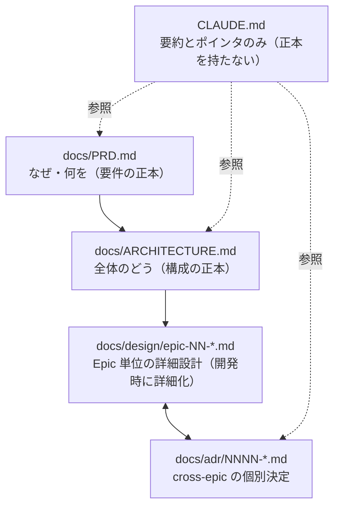
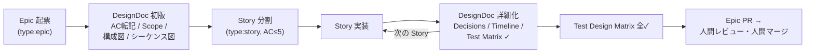

# 開発フロー正典（Epic / Story / DesignDoc / ADR）

このリポジトリが配布する開発フローの正本。CLAUDE.md には要約とポインタのみを置き、
フローの定義は本書を正とする。

## 1. 背景 — なぜこのフローか

要件全体を設計しきってから実装する仕様駆動開発は、仕様文書と生成コードが長大になり、
レビューする人間の認知が追いつかなくなる。このフローは要件を**動作確認できる最小単位
（Story）**に分割し、そのまとまり（Epic）ごとの DesignDoc を**開発しながら詳細化**する
ことで、AI が生成しようとしている／したものと人間の認知状態を近づける。一度に精査する
情報量を絞ることが目的であり、文書を書くこと自体は目的ではない。

経験上、特に効果が高い要素は次の2つで、このフローの**必須要素**とする:

- **ADR** — 設計判断を1決定1ファイルで記録し、「なぜこうなっているか」を後から追える
- **シーケンス図**（mermaid `sequenceDiagram`）— 誰がどの順で何を呼ぶかを人間が一目で検証できる

## 2. 文書階層と正本ルール

| 文書 | 正本として持つもの | 持たないもの |
|---|---|---|
| `docs/PRD.md` | ビジョン、コアバリュー、機能/非機能要件、スコープ外、Epic ロードマップ、成功基準 | 実現方法 |
| `docs/ARCHITECTURE.md` | 不変条件、全体構成図、コンポーネント責務、ディレクトリ構成 | Epic 固有の詳細 |
| `docs/design/epic-NN-*.md` | Epic の AC・Scope・構成図・シーケンス図・責務表・Epic-scoped な決定・Test Design Matrix | cross-epic の決定（→ ADR） |
| `docs/adr/NNNN-*.md` | cross-epic 決定・長期制約・ARCHITECTURE への変更 | Epic 内で完結する決定（→ DesignDoc） |
| `CLAUDE.md` | AI への行動指示と各正本へのポインタ | 上記すべての実体 |

**ルール: 同じ情報を2箇所に正本として書かない。**要約とポインタは可、実体の複製は不可。
CLAUDE.md の肥大化はこのルールで構造的に防ぐ。

## 3. Issue の2階層

| | Epic | Story |
|---|---|---|
| label | `type:epic` | `type:story` |
| 単位 | まとまった価値への一歩。DesignDoc を必ず伴う | **動作確認可能な最小単位**。0.5–3日 |
| Acceptance Criteria | DesignDoc に転記して管理 | **5個以下**。超えたら Story を分割 |
| 起票フォーム | `.github/ISSUE_TEMPLATE/epic.yml` | `.github/ISSUE_TEMPLATE/story.yml` |

分割の判定基準は「レビューする人間が、その単位の DesignDoc と差分を**一度の認知で
精査しきれるか**」。迷ったら小さくする。

## 4. ライフサイクル

1. **Epic 起票** — 目的・AC・スコープ外を書く。PRD のどの要件を前進させるかを必ず書く。
2. **DesignDoc 初版** — [.claude/rules/design-doc-template.md](../.claude/rules/design-doc-template.md)
   を `docs/design/epic-NN-<topic>.md` にコピーして書く。初版で埋めるのは AC 転記・Scope・
   Architecture 図・シーケンス図まで。**全節を最初に埋めきらない**（開発時詳細化がこのフローの核）。
3. **Story 分割** — DesignDoc の構造に沿って Story を起票する。
4. **Story 実装** — 実装のたびに DesignDoc を詳細化する。計画外の判断は Decisions
   （Epic-scoped）か ADR（cross-epic）へ、完了は Story Timeline へ、テストは
   Test Design Matrix へ反映する。
5. **Epic 完了** — Test Design Matrix 全✓ が Epic PR のレビューゲート。
   **AI アシスタントは Epic PR をマージしない。**人間がレビューしてマージする。

## 5. ブランチモデル — トランクベース + Epic stacking

- `main` がトランク。`dev` などの統合ブランチは置かない。
- **Epic**: `epic/<issue番号>-<slug>` を `main` から切る。Epic PR は `main` 向き。
- **Story**: 既定では Epic ブランチに直接コミットする。独立レビューに値する Story のみ
  `(feat|fix|chore|refactor)/<issue番号>-<slug>` を Epic ブランチから切り、
  Epic ブランチへ PR を出す（stacked PR）。
- リリースをタグ駆動（`v*`）にする場合、`main` へのマージはリリースを意味しない。

## 6. ADR 運用（ハードルール）

Story 実装中に、承認済みの計画が想定していなかった設計判断が出たら、PR マージ前に
必ず次のいずれかを行う:

1. **ADR を作る**（既定。アーキテクチャ・ライブラリ選定・公開契約の変更など非自明な判断）。
2. DesignDoc の `## Decisions` に書く（効果がその Epic を超えない場合のみ）。
3. PR 説明に明記して人間に確認する（1 も 2 も過剰といえる小さな判断のみ）。

黙って判断して先へ進むことを禁止する。テンプレートは
[.claude/rules/adr-template.md](../.claude/rules/adr-template.md)、索引は
[docs/adr/README.md](adr/README.md)。
